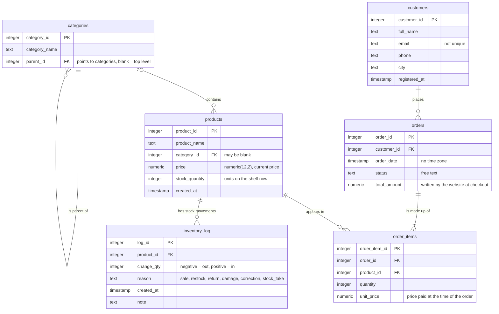

# Kloud Kart — database diagram

How the six tables in `schema.sql` relate to each other. The lines show the
relationships the data is *meant* to follow. **None of them are enforced by
the database today**: there are no foreign keys, so broken links can and do
exist (see `data_findings.md`).

## Reading the lines

| Relationship | Meaning |
|---|---|
| categories → categories | One category can have many subcategories. Each category has at most one parent. A blank `parent_id` means a top-level category. This single table holds the whole tree, at any depth. |
| categories → products | One category holds many products. A product may have no category (`|o` = zero or one). |
| customers → orders | One customer places many orders. Every order should belong to exactly one customer. |
| orders → order_items | One order is made up of one or more lines (`|{` = at least one). |
| products → order_items | One product can appear in many order lines. |
| products → inventory_log | One product has many stock movements. Adding up a product's `change_qty` should equal its `stock_quantity`. |

## Symbol key

| Symbol | Meaning |
|---|---|
| `||` | exactly one |
| `|o` | zero or one |
| `|{` | one or more |
| `o{` | zero or more |
| PK | primary key: uniquely identifies each row |
| FK | foreign key: points to a row in another table (intended, not enforced) |